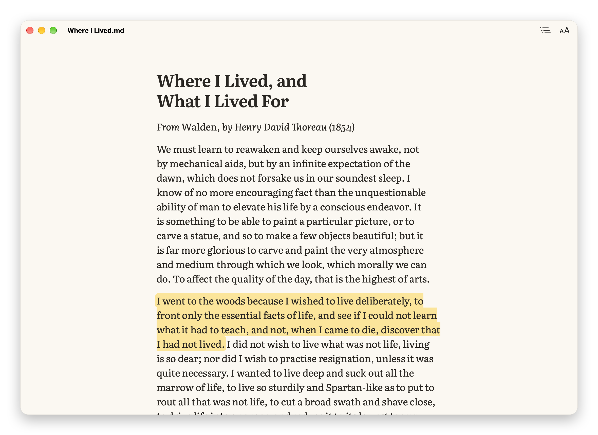
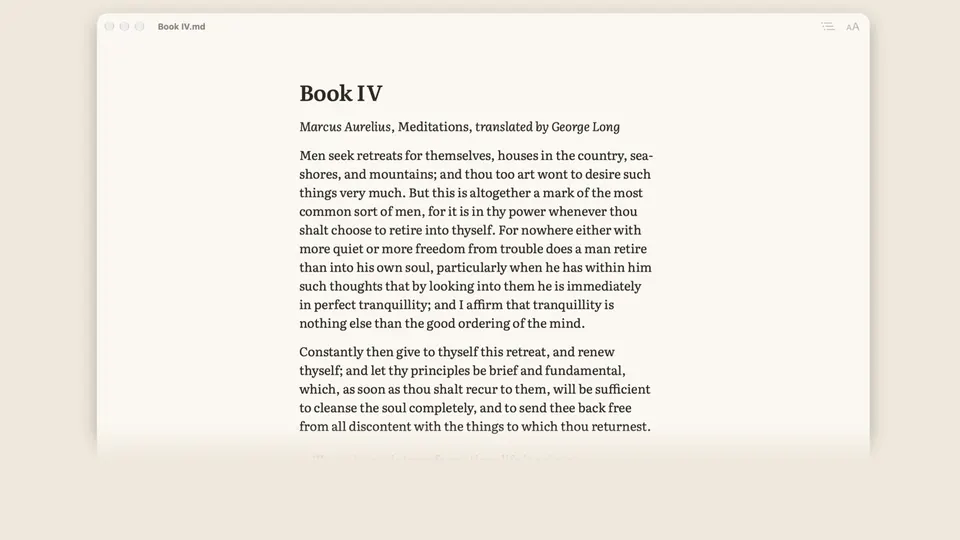
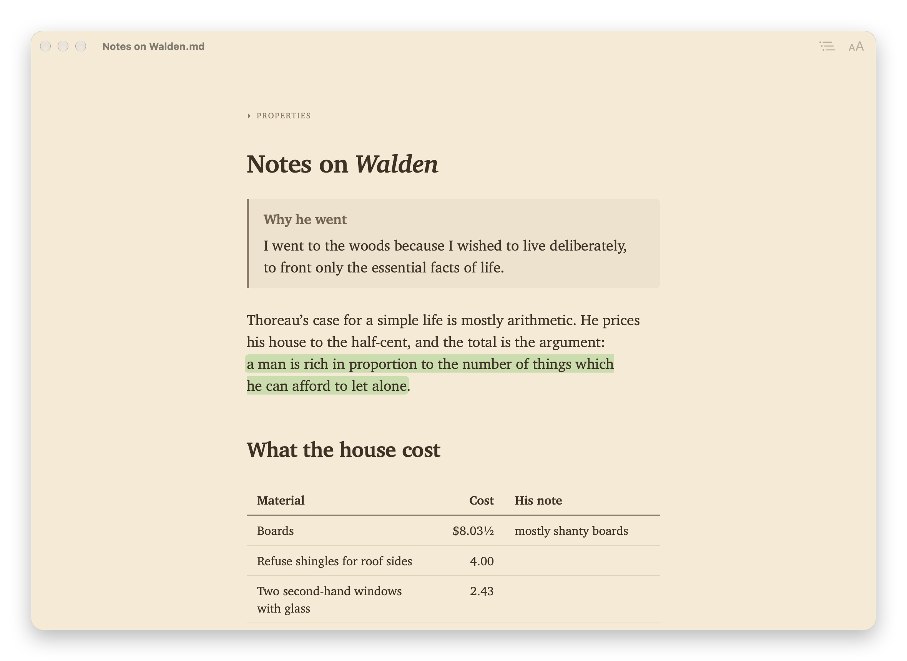
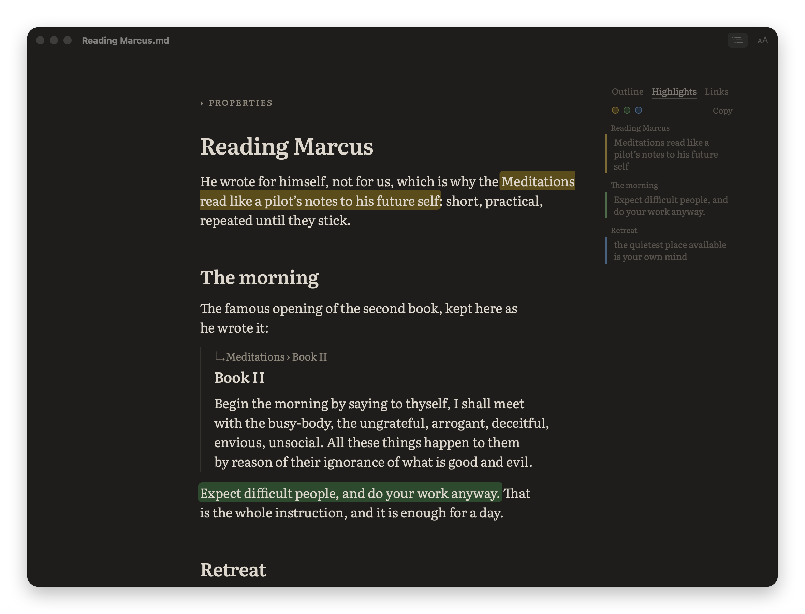
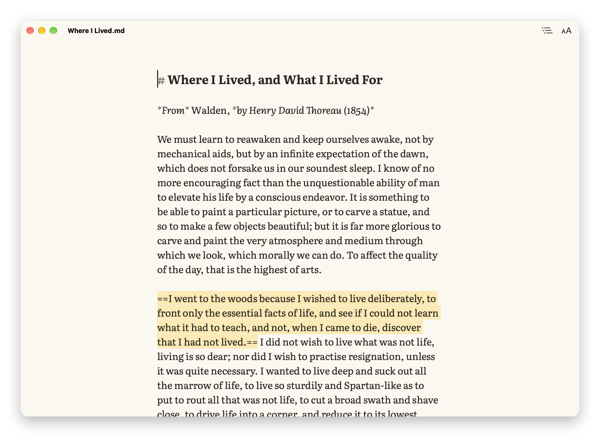

# Leading

Leading is a free Mac app for reading Markdown. It sets a note as a well-made page, in a good typeface, with nothing else on screen. It reads everything a modern note holds: Obsidian vaults with their links, embeds, callouts and highlights, LaTeX math, Mermaid diagrams and code. Then it does what a reader does: it marks passages, lists and quotes them, follows links, and puts the result on paper. There is no account, no subscription and no network connection.

*Said “ledding”, to rhyme with heading.* Leading is the typesetter’s word for the space between lines of type, named after the strips of lead that once held them apart.

<p align="center">
<a href="https://github.com/ifly-777/leading/releases/latest"></a>

<a href="LICENSE"></a>
</p>

<p align="center"></p>

<p align="center"><br><sub>Leading in 28 seconds. Download the film: <a href="https://github.com/ifly-777/leading/raw/main/docs/video/leading.mp4">wide</a> · <a href="https://github.com/ifly-777/leading/raw/main/docs/video/leading-square.mp4">square</a></sub></p>

## Install

Leading needs macOS 26 (Tahoe) or later, on Apple Silicon or Intel.

1. Download **Leading-x.y.z.dmg** from the [latest release](https://github.com/ifly-777/leading/releases/latest).
2. Open it and drag Leading into Applications.
3. Open Leading from Applications.

The first time, macOS will say it could not verify Leading. That is because Leading is not signed with Apple's paid developer certificate, not because anything is wrong with it. To let it through, once:

1. Click **Done** in that message (not Move to Trash).
2. Open **System Settings › Privacy & Security**, scroll down to **Security**, and click **Open Anyway** beside "Leading" was blocked to protect your Mac.
3. Click **Open Anyway** again when macOS asks, and confirm with Touch ID or your password.

The disk image has the same steps, with pictures, as *If macOS blocks Leading.pdf*. Updates do not ask again.

## What it does

### A page worth reading

Five typefaces, three bundled and two from macOS: Literata, Atkinson Hyperlegible Next, iA Writer Quattro, New York and Charter. You can also use any font you have. You set the size, line spacing, column width, paragraph style and justification, in light, sepia or dark. The defaults were chosen with a typography prototype that ships with the source, and the page passes WCAG’s text-spacing test.

Leading remembers where you stopped in every file. An outline of the headings sits in the margin. Footnotes open beside their number, so you never leave the line. Three optional aids help with long reads: a hairline that shows how far through you are and the time left, **Focus** (⌘D), which dims all but the paragraph you are reading, and **Page by Page**, which moves a screen at a time.

<p align="center">


</p>
<p align="center"><sub>Dark, with the outline of headings · Sepia, set in Charter: a note with a callout, a highlight and a table</sub></p>

### Made for Obsidian vaults

Open any note in your vault, where it already lives. There is nothing to import.

- **Wikilinks** open their note as a new tab, at the heading they name. Leading finds the note anywhere in the vault, as Obsidian does.
- **Embeds:** `![[picture.png]]` and `![[Note#Heading]]` appear in place.
- **Link previews:** rest the pointer on a link to glance at the note, or at the section it points to.
- **Callouts, properties and highlights** look as they should. Highlights are read and written in Obsidian’s own `==text==` and Highlightr’s coloured `<mark>`, so the two apps always agree.

<p align="center"></p>
<p align="center"><sub>A vault note in dark: a section embedded from another note, and its highlights listed by section in the margin</sub></p>

### Math, diagrams and code

- **Math:** LaTeX is typeset by KaTeX as the file opens, `$…$` within a line and `$$…$$` on its own. Single dollars follow Obsidian’s rule, so “$5 and $10” stay prices.
- **Diagrams:** Mermaid diagrams are drawn in the theme’s colours and the reading font: flowcharts, sequence, class, state and Gantt diagrams, pie charts, mind maps and more. All twenty types tested draw.
- **Code** is coloured for thirty-one languages, in a quiet palette for each theme.

All of it is bundled with the app, so nothing is fetched from the internet.

<p align="center"></p>
<p align="center"><sub>Inline and display math, a Mermaid diagram and coloured code, in sepia</sub></p>

### Mark it up, take it with you

- **Highlight** with ⇧⌘H, or ⌥⌘1 to ⌥⌘5 for five colours. Each highlight is written into the file.
- **Show Highlights** (⌥⌘L) lists every highlight beside the text, by section. Click one to go there. Copy puts them all on the clipboard as Markdown, colours included.
- **Copy as Quote** (⇧⌘C) copies the selection as a Markdown quotation, with a link back to the note and section it came from.
- **Tick tasks** while reading. ⌘Z undoes a tick, as it undoes a highlight.

### On paper and in Finder

- **Print** (⌘P) and **Export as PDF** set the file for paper, in your typeface, always on light paper.
- **Page breaks** written as Obsidian, Typora or Pandoc write them start a new page. Format › Insert Page Break (⌘↩) adds one.
- **Quick Look:** in Finder, select any Markdown file and press Space to see it as Leading sets it.

### Editing when you need it

⌘E shows the Markdown itself, in the same typeface, and switches back. Changes save as you go, and File › Revert To brings back any earlier version. If another app changes the file, Leading shows the new text without losing your place. Find (⌘F) ignores case, accents and curly quotes. Find and Replace (⌥⌘F), list and table formatting, and smart punctuation work while you edit.

<p align="center"></p>
<p align="center"><sub>⌘E shows the Markdown itself, in the same typeface</sub></p>

### Quick, and private

A typical note is on screen in about a tenth of a second once Leading is running; a 5 MB file, around half a second from a cold start (Apple M2). Leading collects nothing and sends nothing, and it never loads anything from the web, not even images in a note.

## Why Leading?

Obsidian’s reading view, Typora and their kin are editors first, and their reading modes look it. Leading is a reader first: it sets the page, then lets you highlight, quote and print what you read, and edits only when you ask. It is not a notes manager and does not sync. Open a file from Finder, or a note straight from your vault; there is nothing to import.

## Keyboard

| To do this | Press |
| --- | --- |
| Highlight (last colour) · in a colour | ⇧⌘H · ⌥⌘1 to ⌥⌘5 |
| Show highlights · copy them all | ⌥⌘L · ⌥⇧⌘C |
| Copy as Quote | ⇧⌘C |
| Outline · go back after a jump | ⌥⌘O · ⌘[ |
| Focus · reading progress | ⌘D · ⌥⌘P |
| Bigger · smaller · next theme | ⌘+ · ⌘− · ⌥⌘T |
| Narrower or wider column | ⌥⌘[ · ⌥⌘] |
| Find · Find and Replace | ⌘F · ⌥⌘F |
| Edit the Markdown, and back | ⌘E |
| Print · insert a page break | ⌘P · ⌘↩ |

The welcome document that opens the first time lists them all. Help › Welcome to Leading opens it again.

## Privacy

Leading collects nothing and sends nothing. It uses the network for one thing only: if you turn on **Check for updates automatically** (it asks once, and it is off unless you say yes), it asks GitHub once a day whether a newer version exists. Updates are verified with an EdDSA signature before they are installed. Leading › Check for Updates… checks once, on demand.

The Quick Look preview runs in a sandbox. Inside one, macOS’s web engine will not start a page without permission to use the network, so the preview holds that permission. It makes no connection: the page’s security policy forbids every request.

## Build it yourself

You need Xcode (free from the App Store), Node.js and Python 3.10 or later.

```
scripts/build-app.sh       # build/Leading.app
scripts/make-dmg.sh        # build/Leading-x.y.z.dmg
```

Tests:

```
cd web
npm test              # logic: parsing, highlights, smart punctuation, search, layout
npm run test:browser  # in WebKit: rendering, WCAG 1.4.12 text spacing, 5 MB speed, editing
cd ../mac && swift test
cd .. && scripts/selftest-app.sh   # the built app checks its own menus, editing, saving
```

`scripts/screenshots.sh` remakes the pictures above, and `scripts/make-video.sh` the film, from the texts in `docs/screenshots/sources/` and `docs/video/sources/` (public domain, or written for the pictures). `web/` also holds the typography prototype used to choose the defaults (`npm run proto`). [docs/decisions.md](docs/decisions.md) records the choices that are not obvious from the code, and what testing showed.

### Releasing

`scripts/release.sh` builds the app for both kinds of Mac, packs the DMG, signs the update archive with the key in the release Mac's Keychain and writes the update feed. `scripts/release.sh --publish` then pushes `main` with a new tag and publishes the release on GitHub. It runs only from `main`, and only when GitHub’s `main` is already part of it.

## Fonts

Bundled unmodified under the SIL Open Font License 1.1, each with its licence file in its folder in `web/fonts/`: Literata (TypeTogether, for Google), Atkinson Hyperlegible Next (Braille Institute), and iA Writer Quattro and Mono (Information Architects, based on IBM Plex). Leading is not affiliated with iA and does not imitate iA Writer. New York, Charter and SF Mono come with macOS and are not bundled.

Math is set by [KaTeX](https://katex.org) and its own math fonts (MIT, Khan Academy and contributors), and diagrams are drawn by [Mermaid](https://mermaid.js.org) (MIT). Both are bundled with the app.

## Licence

MIT. See [LICENSE](LICENSE).
