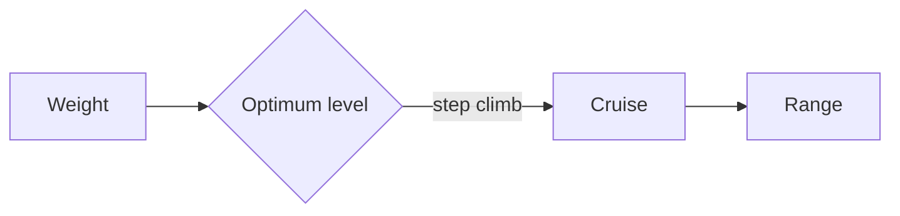

# Lift and range

Lift grows with the square of speed: $L = \tfrac{1}{2}\rho V^2 S C_L$. Halve the air's density, as at 18,000 ft, and the wing needs about $\sqrt{2}$ times the true airspeed to carry the same weight. The fuel that buys the distance is set by Breguet:

$$
R = \frac{V}{c}\,\frac{L}{D}\,\ln\frac{W_i}{W_f}
$$



```python
from math import log

def breguet_range(v_kt, tsfc, l_over_d, w_start, w_end):
    """Still-air range in nm."""
    return v_kt / tsfc * l_over_d * log(w_start / w_end)
```
