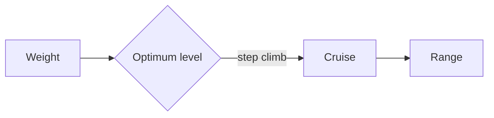

# Lift and range

Lift grows with the square of speed, $L = \tfrac{1}{2}\rho V^2 S C_L$, and the fuel that buys the distance is set by Breguet:

$$
R = \frac{V}{c}\,\frac{L}{D}\,\ln\frac{W_i}{W_f}
$$



```python
def breguet_range(v, c, l_over_d, w_start, w_end):
    return v / c * l_over_d * log(w_start / w_end)
```
