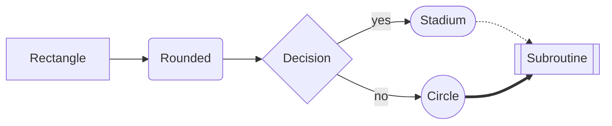
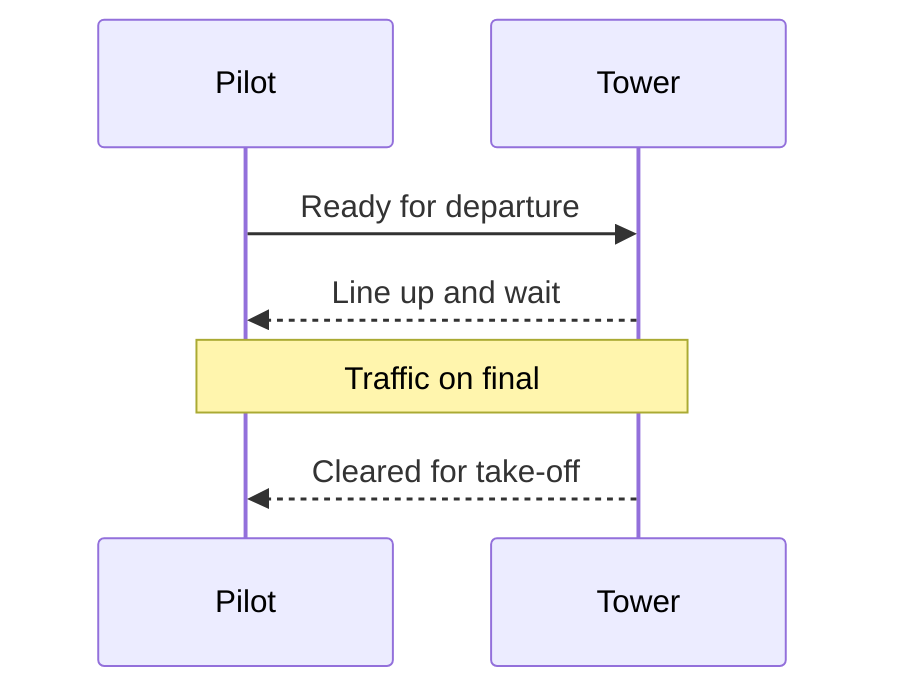
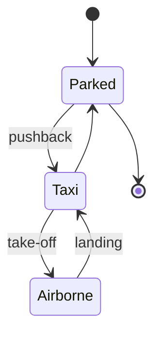
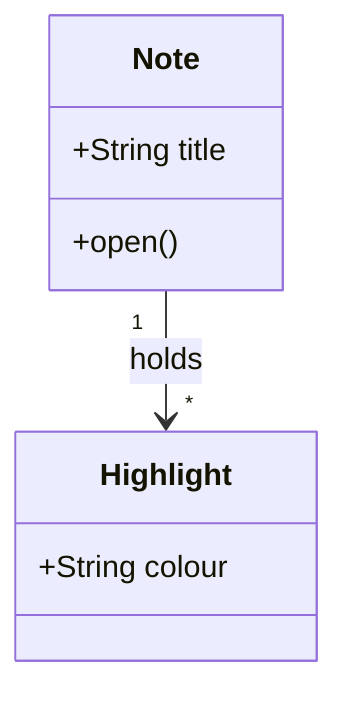
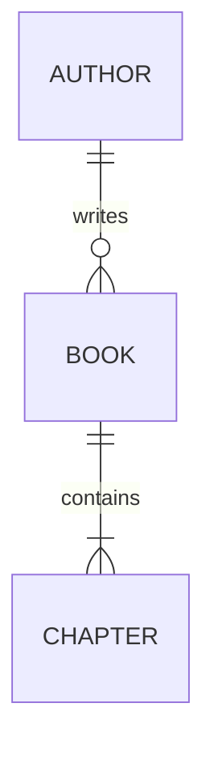
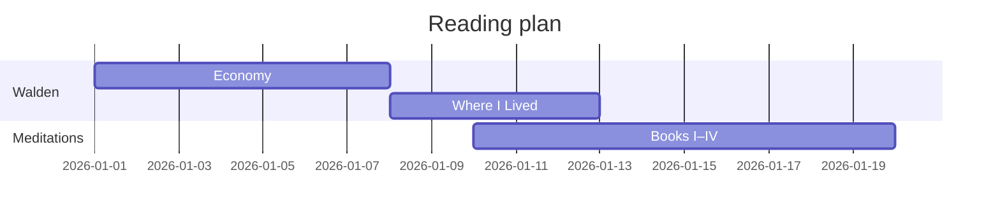
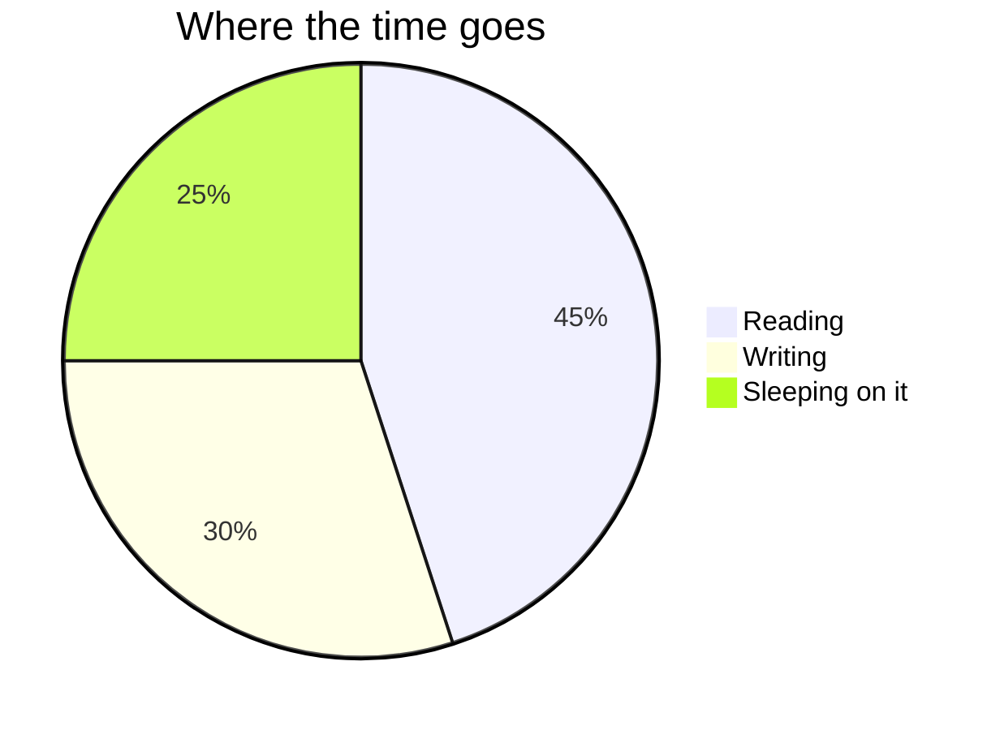
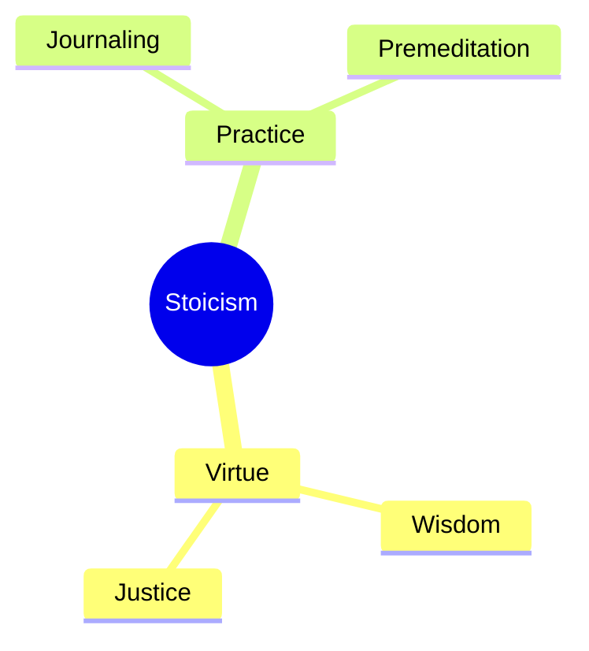
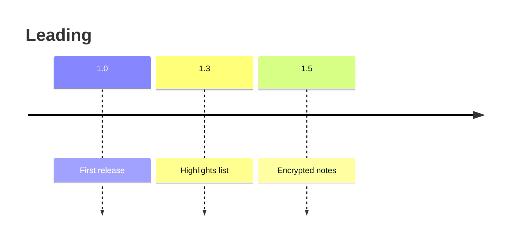

# Leading Guide

This guide covers everything Leading does, and the Markdown it reads: plain Markdown, Obsidian’s additions, LaTeX math and Mermaid diagrams. Where it shows syntax, the source comes first, in a grey block, and the result follows, as Leading sets it. The outline (⌥⌘O) is the quickest way round. Every keyboard shortcut is listed at the end.

You can highlight this guide and tick its tasks, but not edit its text; File › Duplicate (⇧⌘S) makes a copy you can edit. Leading replaces the guide with a fresh copy when it updates, so highlights made here last only until then.

## Opening files

Leading opens Markdown files where they already live. Double-click one in Finder if Leading is your default Markdown app, drag one onto Leading in the Dock, or use File › Open (⌘O). There is nothing to import, and Leading never moves or renames a file unless you ask it to.

Leading also opens `.markdown`, `.mdown`, `.mkd`, `.mkdn` and plain `.txt` files. File › New (⌘N), or opening Leading with no file, gives a blank page to write in; ⌘S saves it as a Markdown file.

Every file opens where you stopped reading it last time. Links to other notes open them in a new tab, at the heading they name, and ⌘[ takes you back. Leading › Settings sets whether Leading is your default app for Markdown, and whether it checks for updates.

## Setting the page

The **Aa** button in the toolbar holds the reading settings. They apply to every file, so you choose them once.

- **Font:** Literata, New York, Charter, Atkinson Hyperlegible Next or iA Writer Quattro, or any font installed on your Mac.
- **Size** (⌘+ and ⌘−, ⌘0 to reset), **line height**, and **line width**: narrow, medium or wide (⌥⌘[ and ⌥⌘]).
- **Theme:** auto, light, sepia or dark (⌥⌘T steps through them). Auto follows macOS.
- **Advanced:** letter and word spacing; paragraphs set with space between or a first-line indent; left or justified alignment; the code font; how highlights look (marker, lowlight or underline); shaded alternate table rows.

The View menu holds the reading aids.

- **Show Outline** (⌥⌘O) lists the headings in the margin. Click one to go there, or use ↑ and ↓, then Return. Esc closes it.
- **Show Reading Progress** (⌥⌘P) draws a hairline showing how far through you are, and the time left at your pace.
- **Focus** (⌘D) dims everything but the paragraph you are reading.
- **Page by Page** moves a screen at a time. Space or → goes forward; ⇧Space or ← goes back. Page Up and Page Down work too.
- **Show as Plain Text** shows the file exactly as written, without Markdown formatting, until you close it.
- **Enter Full Screen** (⌃⌘F) leaves only the page.

A table wider than the column scrolls sideways, with its first column pinned. Double-click a table to see it alone, full window; Esc returns. Right-click a table and choose Copy Table as CSV to take it to a spreadsheet.

## Writing Markdown

Markdown is plain text with a few marks that mean something. A file written in it reads well as it is, in any editor, and Leading sets it as a page. What follows is the Markdown most notes need. Leading reads CommonMark with GitHub’s additions (tables, task lists, strikethrough, footnotes) and Obsidian’s (wikilinks, embeds, callouts, highlights, math), so a note written for any of those reads the same here.

### Paragraphs and line breaks

A blank line starts a new paragraph. A single line break inside a paragraph is ignored, so you can wrap lines however you like. To force a line break without starting a new paragraph, end the line with a backslash.

```markdown
The first paragraph, written
over two lines.

The second paragraph.\
A new line within it.
```

The first paragraph, written
over two lines.

The second paragraph.\
A new line within it.

### Headings

One to six hashes, then a space. The outline is built from them, and links can point at them.

```markdown
# A title
## A section
### A subsection
```

### Emphasis

```markdown
*Italic*, **bold**, ***both***, ~~struck through~~ and `code`.
```

*Italic*, **bold**, ***both***, ~~struck through~~ and `code`.

Underscores work as well as asterisks: `_italic_` and `__bold__`. Inside a word, use asterisks.

### Links and pictures

```markdown
An [inline link](https://example.com), a [reference link][ref], and a bare one: <https://example.com>.

[ref]: https://example.com "A title shown on hover"
```

An [inline link](https://example.com), a [reference link][ref], and a bare one: <https://example.com>.

[ref]: https://example.com "A title shown on hover"

Links to the web open in your browser. A link to another Markdown file, such as `[the notes](Notes.md)` or `[a section](Notes.md#Reading)`, opens it in Leading.

A picture is a link with an exclamation mark before it. The text in brackets describes the picture for anyone who cannot see it.

```markdown

```

Leading shows pictures stored on your Mac; a path is read from the note’s folder. It never loads a picture from the web, so a picture whose address starts with `https://` shows its description instead.

### Quotations

```markdown
> The mass of men lead lives of quiet desperation.
>
> > A quotation within a quotation.
```

> The mass of men lead lives of quiet desperation.
>
> > A quotation within a quotation.

### Lists

A list item starts with `-`, `*` or `+`, or with a number and a full stop. Indent an item by two or four spaces to nest it under the one above.

```markdown
- Bread
- Milk
  - Whole
  - Skimmed

1. Preheat the oven.
2. Mix the dough.
3. Bake.
```

- Bread
- Milk
  - Whole
  - Skimmed

1. Preheat the oven.
2. Mix the dough.
3. Bake.

A numbered list counts from its first number, whatever numbers follow, so `1.` on every line still reads 1, 2, 3.

### Tasks

```markdown
- [ ] Not done
- [x] Done
```

- [ ] Not done
- [x] Done

Click a box to tick it while you read. Leading writes the tick into the file, and ⌘Z undoes it.

### Code

A word or two of code goes between backticks. A longer piece goes between lines of three backticks, with the language named after the first three so Leading can colour it.

````markdown
```python
def lift(rho, v, s, cl):
    return 0.5 * rho * v**2 * s * cl
```
````

```python
def lift(rho, v, s, cl):
    return 0.5 * rho * v**2 * s * cl
```

See [Code](#code) for the languages Leading colours.

### Tables

Columns are separated by bars, and a line of dashes divides the header from the rows. Colons in that line set the alignment: left, centre or right.

```markdown
| Runway | Length (m) | Surface |
| :--- | ---: | :---: |
| 12L | 4,000 | Asphalt |
| 30R | 4,450 | Asphalt |
```

| Runway | Length (m) | Surface |
| :--- | ---: | :---: |
| 12L | 4,000 | Asphalt |
| 30R | 4,450 | Asphalt |

The bars need not line up. While editing, Format › Table (⇧⌘T) inserts one, Tab moves to the next cell, and Leading lines the bars up for you.

### Rules and footnotes

Three dashes on a line of their own draw a rule across the page.

```markdown
A sentence that needs a source.[^1]

---

[^1]: The source, which Leading shows beside the number.
```

A sentence that needs a source.[^1]

---

[^1]: The source, which Leading shows beside the number. Esc or a click anywhere else closes it; ⌥-click the number to go to the notes at the end instead.

Footnotes can be named rather than numbered (`[^walden]`); Leading numbers them in order.

### Escaping

A backslash before a mark makes it plain text: `\*not italic\*` reads \*not italic\*, and `\$` is a dollar sign that never starts math.

### Properties

A note can begin with properties, as Obsidian calls them: YAML between two lines of three dashes. Leading shows them as one quiet line, which opens to show them all.

```markdown
---
title: Meditations
author: Marcus Aurelius
tags: [stoicism, reading]
---
```

A `lang` property (or `language`) names the language a note is written in, as a language code: `lang: de` for German, `lang: en-GB` for British English. Leading then hyphenates the note by that language’s rules, on screen and on paper. A note without one is read as English.

### Punctuation

Leading sets straight quotes as curly ones, two hyphens as an en dash and three as an em dash, and three full stops as an ellipsis, on the page only. The file keeps what you typed. Code and math are left alone.

### HTML

Markdown allows HTML for what it cannot say itself. Leading keeps the harmless parts: `<mark>`, `<u>`, `<kbd>`, `<small>`, `<abbr>`, `<sub>`, `<sup>`, `<br>`, and `<details>` with `<summary>` for a section that opens on a click. Scripts, styles and event handlers are removed.

```markdown
Press <kbd>⌘</kbd><kbd>E</kbd> to edit. H<sub>2</sub>O, E = mc<sup>2</sup>.

<details>
<summary>Show the answer</summary>

Forty-two.

</details>
```

Press <kbd>⌘</kbd><kbd>E</kbd> to edit. H<sub>2</sub>O, E = mc<sup>2</sup>.

<details>
<summary>Show the answer</summary>

Forty-two.

</details>

## Notes from Obsidian

Open any note in your vault where it lives. Leading finds the vault from the note, and reads Obsidian’s additions to Markdown.

### Wikilinks

```markdown
[[Meditations]]
[[Meditations#Book IV]]
[[Meditations|Marcus]]
```

A wikilink names a note without its folder or `.md`. Leading finds it anywhere in the vault, as Obsidian does, and opens it in a new tab. A `#` sends it to a heading; a bar gives the link its own text. Rest the pointer on a link for a moment to see a preview of the note, or of the section it names.

### Embeds

An exclamation mark before a wikilink puts the thing itself in the page.

```markdown
![[diagram.png]]
![[Meditations#Book IV]]
```

A picture appears in place; a note, or one section of it, appears in a quiet frame. To change an embedded note, open the note itself.

### Callouts

A callout is a quotation whose first line names its kind in brackets. Text after the kind is its title.

```markdown
> [!tip] Before you begin
> Callouts can hold any Markdown, **lists** and `code` included.

> [!warning]- Folded until clicked
> A minus after the kind folds the callout shut; a plus folds it open.
```

> [!tip] Before you begin
> Callouts can hold any Markdown, **lists** and `code` included.

> [!warning]- Folded until clicked
> A minus after the kind folds the callout shut; a plus folds it open.

Leading colours the kinds Obsidian does: note and info; tip and abstract; success; question; warning; failure, danger and bug; example; and quote. Obsidian’s other names for them work too: summary, tldr, hint, important, check, done, help, faq, caution, attention, fail, missing, error and cite. Any other kind takes the colour of a note.

### Highlights

```markdown
==Highlighted in yellow==, and <mark style="background: #BBFABBA6;">in green</mark>.
```

==Highlighted in yellow==, and <mark style="background: #BBFABBA6;">in green</mark>.

Leading writes highlights the way Obsidian and its Highlightr plugin do, so the two apps always agree. You rarely need to type them: see [Highlighting and quoting](#highlighting-and-quoting).

## Highlighting and quoting

Select some text and press ⇧⌘H to highlight it in the colour you used last, or choose one: ⌥⌘1 yellow, ⌥⌘2 green, ⌥⌘3 blue, ⌥⌘4 pink, ⌥⌘5 orange. ⌥⌘0 removes a highlight. Yellow is written as `==text==`, the others as Highlightr’s `<mark>`. ⌘Z undoes a highlight.

**Show Highlights** (⌥⌘L) lists every highlight in the margin, by section; click one to go there. **Copy All Highlights** (⌥⇧⌘C) puts them on the clipboard as Markdown, colours included.

**Copy as Quote** (⇧⌘C) copies the selection as a Markdown quotation, with a link back to the note and the section it came from. Paste it into another note and the link leads home.

## Math

Leading typesets LaTeX math with KaTeX, as the file opens. Math between single dollars sits within a line; math between double dollars stands on its own, centred.

```markdown
The energy is $E = mc^2$.

$$
\int_0^1 x^2\,dx = \frac{1}{3}
$$
```

The energy is $E = mc^2$.

$$
\int_0^1 x^2\,dx = \frac{1}{3}
$$

A single dollar follows Obsidian’s rule, so prices stay prices. It opens math only when the next character is not a space, and closes it only when the character before is not a space and the one after is not a digit. “It costs $5 and $10” reads as written.

The rule can still pair a price with a later dollar in the same paragraph and set the words between as math. When a dollar sign must stay a dollar sign, put a backslash before it: `\$`.

### A cookbook

Each line below shows the source, then the result.

| Write | To get |
| --- | --- |
| `$x^2$`, `$x_i$`, `$x_{i,j}^{n+1}$` | $x^2$, $x_i$, $x_{i,j}^{n+1}$ |
| `$\frac{a}{b}$`, `$\tfrac{1}{2}$` | $\frac{a}{b}$, $\tfrac{1}{2}$ |
| `$\sqrt{x}$`, `$\sqrt[3]{x}$` | $\sqrt{x}$, $\sqrt[3]{x}$ |
| `$\alpha, \beta, \gamma, \Delta, \Omega$` | $\alpha, \beta, \gamma, \Delta, \Omega$ |
| `$\sum_{n=1}^{N} a_n$` | $\sum_{n=1}^{N} a_n$ |
| `$\int_a^b f(x)\,dx$` | $\int_a^b f(x)\,dx$ |
| `$\lim_{x \to 0} \frac{\sin x}{x}$` | $\lim_{x \to 0} \frac{\sin x}{x}$ |
| `$\frac{\partial f}{\partial x}$`, `$\nabla f$` | $\frac{\partial f}{\partial x}$, $\nabla f$ |
| `$\bar{x}$`, `$\hat{y}$`, `$\vec{v}$`, `$\dot{x}$` | $\bar{x}$, $\hat{y}$, $\vec{v}$, $\dot{x}$ |
| `$\le, \ge, \ne, \approx, \equiv, \propto$` | $\le, \ge, \ne, \approx, \equiv, \propto$ |
| `$\times, \div, \pm, \cdot, \infty$` | $\times, \div, \pm, \cdot, \infty$ |
| `$\to, \Rightarrow, \iff, \in, \subset, \cup, \cap$` | $\to, \Rightarrow, \iff, \in, \subset, \cup, \cap$ |
| `$\mathbb{R}, \mathcal{L}, \mathbf{F}$` | $\mathbb{R}, \mathcal{L}, \mathbf{F}$ |
| `$\left( \frac{a}{b} \right)$` | $\left( \frac{a}{b} \right)$ |
| `$\text{if } x > 0$` | $\text{if } x > 0$ |
| `$50\,\%$`, `$90^\circ$` | $50\,\%$, $90^\circ$ |

Inside a table, a bar in math must be written `\vert` or `\|`, because a plain `|` ends the cell.

### Longer formulas

Equations that line up use `aligned`, with `&` before the sign to align on and `\\` between lines.

```markdown
$$
\begin{aligned}
L &= \tfrac{1}{2} \rho v^2 S C_L \\
  &= W \quad \text{in level flight}
\end{aligned}
$$
```

$$
\begin{aligned}
L &= \tfrac{1}{2} \rho v^2 S C_L \\
  &= W \quad \text{in level flight}
\end{aligned}
$$

A function defined in pieces uses `cases`:

```markdown
$$
|x| = \begin{cases} x & \text{if } x \ge 0 \\ -x & \text{otherwise} \end{cases}
$$
```

$$
|x| = \begin{cases} x & \text{if } x \ge 0 \\ -x & \text{otherwise} \end{cases}
$$

Matrices use `pmatrix` for round brackets, `bmatrix` for square ones and `vmatrix` for a determinant:

```markdown
$$
\begin{pmatrix} a & b \\ c & d \end{pmatrix}
\begin{bmatrix} x \\ y \end{bmatrix}
$$
```

$$
\begin{pmatrix} a & b \\ c & d \end{pmatrix}
\begin{bmatrix} x \\ y \end{bmatrix}
$$

### When math goes wrong

A formula KaTeX cannot read is shown in red as written, so you can see what to fix; the rest of the page is unaffected. KaTeX covers most of LaTeX’s math, but not document commands such as `\usepackage`, chemistry notation (`\ce`), or drawing packages such as TikZ. KaTeX’s list of supported functions, at katex.org/docs/supported, has the rest.

## Diagrams

Leading draws Mermaid diagrams: a code block named `mermaid`, holding a short text description of the diagram. Diagrams are drawn in the theme’s colours and the reading font, and redrawn when the theme changes. Mermaid is bundled with Leading, so nothing is fetched from the web.

Each example below shows the source, then the diagram.

### Flowcharts

A flowchart starts with `flowchart` (or `graph`) and a direction: `LR` left to right, `TD` top down, `RL` or `BT`. Each node has an id and, optionally, a label in brackets whose shape sets the shape of the box. Arrows join them, with an optional label between bars.

````markdown

````



`-->` is a plain arrow, `-.->` a dotted one, `==>` a thick one, and `---` a line without a head. Group nodes with `subgraph Title` and `end`. A label holding brackets or other punctuation goes in quotes: `A["Fuel (kg)"]`.

### Sequence diagrams

Who says what to whom, in order. `->>` is a call, `-->>` a reply.

````markdown

````


### State diagrams

````markdown

````


### Class diagrams

````markdown

````


### Entity relationships

````markdown

````


### Gantt charts

````markdown

````


### Pie charts

````markdown

````


### Mind maps

Indentation sets the branches.

````markdown

````


### Timelines

````markdown

````


### Other kinds

Mermaid draws more than these: user journeys, Git graphs, quadrant charts, XY charts, Sankey diagrams, requirement diagrams, C4 diagrams, block diagrams, packet diagrams, architecture diagrams, kanban boards and radar charts. The Mermaid documentation, at mermaid.js.org, describes each.

A diagram Mermaid cannot read is replaced by a line saying what went wrong, and the rest of the page is unaffected. Most mistakes are a missing direction after `flowchart`, a label with brackets or a colon that needs quotes, or a word Mermaid reserves, such as `end`, used as a node id.

## Code

A code block is coloured when it names its language. Leading colours Bash and shell, C, C++, C#, CSS, diff, Dockerfile, Go, INI and TOML, Java, JavaScript, JSON, Kotlin, LaTeX, Lua, Makefile, Markdown, Objective-C, Perl, PHP, Python, R, Ruby, Rust, SCSS, SQL, Swift, TypeScript, XML and HTML, and YAML. Common short names work too: `sh`, `zsh`, `js`, `ts`, `jsx`, `tsx`, `py`, `html`, `toml`. Blocks in other languages are shown plain.

## Editing

⌘E switches between reading and editing the Markdown itself, in the same typeface; press it again to read. Changes save as you go. File › Revert To › Browse All Versions brings back any earlier state of the file.

| Format | Press |
| --- | --- |
| Bold, italic, underline | ⌘B, ⌘I, ⌘U |
| Strikethrough | ⇧⌘X |
| Code | ⌥⌘C |
| Link | ⌘K |
| Bulleted or numbered list | ⌘L or ⇧⌘L |
| Table | ⇧⌘T |
| Page break | ⌘↩ |

Select text with the pointer and a small bar appears above it, for formatting and highlight colours. Quotes and dashes become curly quotes and proper dashes as you type; Format › Smart Punctuation While Typing turns that off.

If another app changes a file you have open, Leading shows the new text without losing your place. If you had unsaved edits, it asks which to keep, and puts the other into the version history, so nothing is lost.

### Find and replace

Find (⌘F) ignores case, accents and curly quotes, so “cafe” finds “Café”. Return or ⌘G goes to the next match, ⇧Return or ⇧⌘G to the one before, and Esc closes the bar. Find and Replace (⌥⌘F) works while editing.

## Printing and Quick Look

File › Print (⌘P) and File › Export as PDF set the file for paper, in your typeface, always on light paper. Leading starts a new page wherever the file asks for one, in any of the forms notes already use:

```markdown
<div style="page-break-after: always"></div>

<!-- pagebreak -->

\newpage
```

Format › Insert Page Break (⌘↩) adds the first form while you edit.

In Finder, select a Markdown file and press Space: Quick Look shows it as Leading sets it.

## Encrypted notes

File › Encrypt… protects one note with a password, using AES-256. The file keeps its name and stays Markdown, so links to it and sync still work; other apps see only a short notice above a block of letters and numbers.

To read it, open it in Leading and enter the password. Leading locks every encrypted note when the Mac sleeps, its lid closes or the screen locks, and Lock Encrypted Notes (⌃⌘L) locks them at once. File › Change Password… and File › Remove Encryption… do what they say.

> [!danger] Never edit an encrypted note in another app
> In Obsidian, a text editor or anywhere else but Leading, an encrypted note is a notice above a block of letters and numbers. **Change one letter or digit of that block — a keystroke, a paste, a stray Backspace — and the file can no longer be opened, not even with the right password.** The encryption checks every character, and a damaged block cannot be repaired.
>
> Edits can happen without your meaning them. Watch for:
>
> - formatter and linter plugins, such as Obsidian Linter or Prettier, that tidy files on save;
> - find-and-replace across a whole vault or folder;
> - sync conflicts that a service merges for you;
> - templating, AI or other plugins that rewrite notes;
> - selecting everything in the note and typing.
>
> Viewing an encrypted note elsewhere is safe, and so are moving, renaming, syncing and linking to it. To change it, open it in Leading, enter the password, and edit it there; Leading encrypts it again as it saves.

### If a note was damaged

Each time Leading saves or opens an encrypted note, it keeps a copy of the encrypted file in the note’s version history. If another app later damages the note, enter its password as usual: Leading tries it on those copies too. When one opens, Leading says the note was changed outside Leading, gives the date of the copy, and offers to restore it. Anything written after that date is lost. The copies are encrypted with the same password, so keeping them reveals nothing.

This is a safety net, not a backup. The copies live only on this Mac, so they cannot help with a note damaged on another Mac and synced here, or one Leading has never opened on this Mac. Someone with administrator access can delete them.

There is no way to recover a note whose password is forgotten. Copies made before you encrypted it, in Time Machine or a sync service’s history, still hold the plain text. If a note matters, keep a backup copy of the encrypted file somewhere a plugin cannot touch it.

If the first line, `<!-- leading-encrypted v1 -->`, is deleted, Leading shows the file as plain text instead of asking for the password. Putting that line back as the first line restores it, as long as the block below is untouched.

## Privacy and updates

Leading has no account, collects nothing and sends nothing. It never loads anything from the web, not even pictures in a note. The only time it uses the network is to ask GitHub, once a day, whether a newer version exists, and only if you turned that on. Leading › Settings changes that choice, and Leading › Check for Updates… checks once. Updates are checked against a signature before they are installed.

## Keyboard shortcuts

### Reading

| To do this | Press |
| --- | --- |
| Make the text bigger or smaller | ⌘+ (or ⌘=) and ⌘− |
| Reset the text size | ⌘0 |
| Narrow or widen the column | ⌥⌘[ and ⌥⌘] |
| Next theme (auto, light, sepia, dark) | ⌥⌘T |
| Show or hide the outline | ⌥⌘O |
| Go back after following a link or heading | ⌘[ |
| Show reading progress | ⌥⌘P |
| Focus on the paragraph being read | ⌘D |
| Full screen | ⌃⌘F |
| Next or previous screen, in Page by Page | Space or → · ⇧Space or ← |
| Close a footnote, preview, outline or table view | Esc |
| Go to a footnote’s note at the end | ⌥-click the number |

### Highlighting and copying

| To do this | Press |
| --- | --- |
| Highlight in the last colour | ⇧⌘H |
| Highlight yellow, green, blue, pink, orange | ⌥⌘1 to ⌥⌘5 |
| Remove a highlight | ⌥⌘0 |
| Show highlights | ⌥⌘L |
| Copy all highlights | ⌥⇧⌘C |
| Copy as Quote | ⇧⌘C |
| Undo or redo | ⌘Z and ⇧⌘Z |

### Finding

| To do this | Press |
| --- | --- |
| Find | ⌘F |
| Next or previous match | ⌘G and ⇧⌘G, or Return and ⇧Return |
| Find and Replace | ⌥⌘F |

### Editing

| To do this | Press |
| --- | --- |
| Switch between reading and editing | ⌘E |
| Bold, italic, underline | ⌘B, ⌘I, ⌘U |
| Strikethrough | ⇧⌘X |
| Code | ⌥⌘C |
| Link | ⌘K |
| Bulleted list | ⌘L |
| Numbered list | ⇧⌘L |
| Table | ⇧⌘T |
| Insert page break | ⌘↩ |
| Cut, copy, paste, select all | ⌘X, ⌘C, ⌘V, ⌘A |

### Files and windows

| To do this | Press |
| --- | --- |
| New page | ⌘N |
| Open | ⌘O |
| Save | ⌘S |
| Duplicate | ⇧⌘S |
| Close | ⌘W |
| Print | ⌘P |
| Lock encrypted notes | ⌃⌘L |
| Minimise | ⌘M |
| Settings | ⌘, |
| This guide | ⌘? |
| Hide Leading · hide others | ⌘H · ⌥⌘H |
| Quit | ⌘Q |
