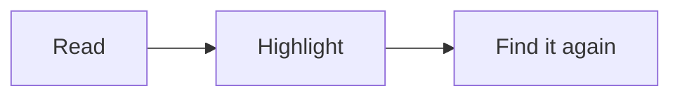

# Welcome to Leading

Leading shows Markdown files as a well-set page: a calm column of text, good fonts, and nothing else on screen. It reads the files you already have, wherever they live, and leaves them as it found them unless you choose to edit or highlight.

This page is an ordinary Markdown file, kept for you in Leading’s own folder. Try anything on it. If you spoil it, delete it and choose Help › Welcome to Leading for a fresh copy.

## Reading

Open a file from Finder, or drag one onto Leading in the Dock. If you said yes when Leading first opened, double-clicking any `.md` file brings it here.

The **Aa** button in the toolbar sets the font, size, line spacing, column width and theme. The settings apply to every document, so you choose them once. The button beside it shows an outline of the headings; click one to jump there.

Close a file and open it again later, and it opens where you stopped. Click a footnote number and the note appears beside it, so you never lose your line.[^1] Links to other notes, `[[wikilinks]]` included, open those notes, at the heading they name.

| To do this | Press |
| --- | --- |
| Make the text bigger or smaller | ⌘+ and ⌘− (⌘0 to reset) |
| Narrow or widen the column | ⌥⌘[ and ⌥⌘] |
| Change theme (auto, light, sepia, dark) | ⌥⌘T |
| Show or hide the outline | ⌥⌘O |
| Go back after jumping to a heading or note | ⌘[ |
| Show how far through you are, and the time left | ⌥⌘P |
| Dim all but the paragraph you are reading | ⌘D |
| List your highlights beside the text | ⌥⌘L |
| Copy the selection as a quotation, with a link back | ⇧⌘C |
| Print, or File › Export as PDF | ⌘P |
| Start a new page there, when printed (while editing) | ⌘↩ |
| Find | ⌘F, then ⌘G for the next match |
| Lock every encrypted note (File › Encrypt… sets one up) | ⌃⌘L |

> [!tip] Notes from Obsidian
> Leading reads Obsidian’s callouts like this one, its wikilinks and its highlights, and shows a note’s properties as one quiet line you can open.

Math is typeset as Obsidian writes it: $e^{i\pi} + 1 = 0$ between single dollars, and a display formula between double ones. A dollar before a price stays a dollar, so $5 and $10 read as written.

$$
\int_0^1 x^2\,dx = \frac{1}{3}
$$

Code is coloured when its block names the language, and tasks tick while you read:

- [ ] Tick me
- [ ] And me

Notes from your vault can be embedded with `![[Note]]`, pictures with `![[picture.png]]`; rest the pointer on a link to another note to glance at it. In Finder, select a Markdown file and press Space to see it set as Leading sets it.

Mermaid diagrams are drawn in the page’s colours:

## Highlighting

Select some text and press ⇧⌘H, or pick a colour with ⌥⌘1 to ⌥⌘5 (yellow, green, blue, pink, orange). ⌥⌘0 removes a highlight. Try it on this sentence.

Highlights are written into the file the way Obsidian and its Highlightr plugin write them, so they show up there too. Yellow becomes `==text==`, which ==looks like this==. ⌘Z undoes a highlight, as it undoes typing.

## Editing

⌘E switches between reading and editing the Markdown itself; press it again to read. Changes save as you go, and File › Revert To › Browse All Versions brings back any earlier state. Find and Replace is ⌥⌘F.

| Format | Press |
| --- | --- |
| Bold, italic, underline | ⌘B, ⌘I, ⌘U |
| Strikethrough | ⇧⌘X |
| Code | ⌥⌘C |
| Link | ⌘K |
| Bulleted or numbered list | ⌘L or ⇧⌘L |
| Table | ⇧⌘T |

Quotes and dashes become curly quotes and proper dashes as you type. Turn that off in Format › Smart Punctuation While Typing.

If another app changes a file you have open, Leading shows the new version. If you had unsaved edits, it asks which to keep, and puts the other into the version history so nothing is lost.

## A new page

Open Leading with no file, or press ⌘N, and you get a blank page ready to write in. Save it with ⌘S; it becomes a Markdown file.

## Privacy

Leading has no account, collects nothing and sends nothing. The only time it uses the network is to check for a new version, and only if you turned that on. Leading › Settings changes that choice, and the default app for Markdown files, at any time.

[^1]: Like this. Press Esc or click anywhere else to close it; ⌥-click a number to go to the notes at the end instead.

---

Leading is free and open source under the MIT licence. Its fonts, Literata, Atkinson Hyperlegible Next and iA Writer Quattro, are used under the SIL Open Font License. Help › Leading on GitHub has the source, and the place to report a problem.
