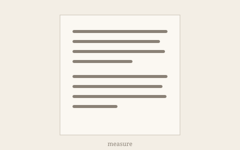

# Typography torture test

Each section below is a trap for smart punctuation, wrapping or rendering. Read it in every font; nothing here should look broken.

## Quotes and apostrophes

"Double quotes," she said, "should curl both ways." 'Single quotes' too. It's, don't, rock 'n' roll, the '90s, 'tis the season, and the Smiths' house. A quote after formatting: **bold**'s apostrophe and "*emphasised*" text. Nested: "She said 'hello' and left." Quotes around a [link](https://example.com): "[linked words](https://example.com)". A quote that opens a paragraph:

"Like this one."

Primes for feet and inches are a known compromise: 6'2" becomes curly, which is wrong but conventional in prose.

## Dashes and ellipses

An en dash for ranges -- pages 10--20 -- and an em dash---like this---for breaks. Three dots... become an ellipsis. Four.... keep a full stop. A dash at the start of a line:

-- quoted speaker

## Things that must never change

- Inline code: `"quotes" -- and ... dots` stays exactly as typed.
- URLs: https://example.com/a--b/c...d?q="x" and www.example.com/it's--fine stay intact.
- An autolink: <https://example.com/--path--/>
- Escapes: \*not italic\*, \_not either\_, \`not code\`, \# not a heading.
- Entities: &copy; 2026, &amp;, &mdash;, &#8220;numeric&#8221;, &lt;tag&gt;.

```js
// Code blocks are never touched: "quotes", it's, -- and ...
const s = 'single' + "double" -- 1
```

## Scripts and languages

Arabic flows right to left: العربية لغة جميلة، والقراءة متعة للعقل.

Hindi in Devanagari: पढ़ना मन के लिए वैसा ही है जैसा व्यायाम शरीर के लिए।

Mixed: The word «typographie» in French, „Typografie" in German, and 「組版」 in Japanese.

Emoji and symbols: ✈️ 📖 ☕︎ — and maths symbols: ≤ ≥ ≠ ± × ÷ ∞.

## Wrapping

A very long word: Pneumonoultramicroscopicsilicovolcanoconiosis, and a very long URL without spaces: https://example.com/this/is/a/very/long/path/that/goes/on/and/on/without/any/spaces/to/break/at/all.html

A path: /Users/someone/Library/Application\ Support/Leading/Preferences/com.example.leading.plist

## Lists, deeply nested

- One
  - Two
    - Three
      - Four, with a paragraph long enough to wrap onto a second line so the hanging indent can be checked.
1. First
2. Second
   1. Second-first
   2. Second-second
10. Tenth, which needs a wider number column.

## Headings at every level

### Third level
#### Fourth level
##### Fifth level
###### Sixth level

## Inline HTML

<u>Underlined with a u tag</u>, <kbd>⌘E</kbd> as a key, H<sub>2</sub>O and E = mc<sup>2</sup>.

<details><summary>A details element</summary>

Hidden content inside.

</details>

<script>alert("scripts are removed")</script>

<div onclick="alert('handlers are removed')" style="color:red">A div whose script and style are stripped.</div>

<!-- An HTML comment is invisible. -->

## Images

A local image, relative to this file:



A remote image, which Leading never loads: 

---

The end.
